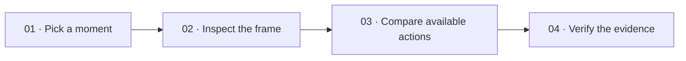
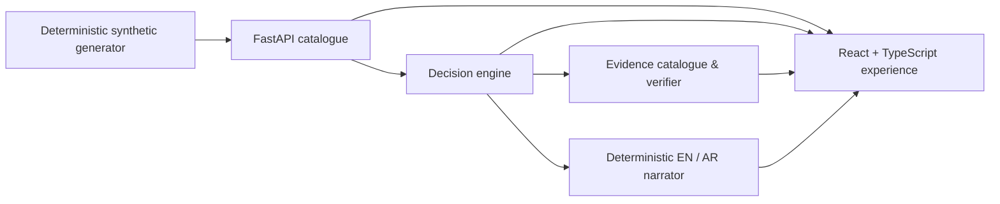

<div align="center">
  

  # ReMatch

  ### Rewind the moment. See the options. Follow the evidence.

  **An evidence-first football intelligence experience for exploring _why_ a decision mattered.**

  [](rematch-frontend)
  [](backend)
  [](#the-data-behind-the-demo)
  [](#roadmap)

  [Get started](#run-it-locally) · [Explore the API](#api-at-a-glance) · [Understand the scoring](docs/decision-engine.md) · [Read the docs](#documentation)
</div>

---

## The idea

Most match products can tell you that a pass was played. ReMatch lets you stop on that moment, see the frame around it, compare the action with the options that were actually present, and trace every computed claim back to evidence.

It is deliberately opinionated about what it will _not_ pretend to know. ReMatch is a deterministic geometry-based explainer—not xG, a pass-completion model, betting advice, or proof that a footballer made the objectively “right” choice.



## What you can explore

| Experience | What it gives you |
|---|---|
| **Match catalogue** | Searchable synthetic fixtures, filterable by status, with an at-a-glance dataset overview. |
| **Match analysis** | A pitch view, event timeline, event inspector, score context, players, and aligned frames. |
| **Decision Explorer** | Backend-scored observed actions and frame-backed alternatives, ranked with transparent calculations. |
| **Pick Your Pass** | An interactive way to inspect alternatives already returned by the engine—without recalculating or inventing scores in the browser. |

| **Judge Mode** | Guided path for reviewers: open a seeded match, replay events, inspect decisions. |
| **Fan / Analyst views** | Presentation mode toggle (local preference) for simpler vs denser wording. |
| **Broadcast-style overlay** | Optional timed strip + downloadable overlay JSON for a moment (synthetic). |
| **Foundry-ready API tools** | OpenAPI export and agent instructions under `docs/` for Microsoft Foundry; the app does not call Foundry from the browser by default. |

| **Evidence & narration** | Claim references, calculation checks, and deterministic English/Arabic narrative output that states limitations clearly. |

### Built to show its working

Every decision analysis is grounded in one observable frame of synthetic match data:

- The backend, not an AI model or the UI, calculates scores and ranks.
- Alternatives are created only for teammates positioned in the event’s aligned frame.
- Claims include references to source events, frames, positions, and registered calculations.
- The verifier validates evidence/reference membership and calculation consistency; it does not certify a free-form statement as football truth.
- The client keeps mock and API modes separate. An API failure is shown to the user—it never silently swaps in mock data.

## How scoring works

The current method, `geometric_progression_v1`, asks a narrow and explainable question: **how far does an action progress toward the opponent’s goal in this coordinate system?**

```text
composite score = progressive distance + goal-proximity gain
```

`progressive distance` measures movement in the team’s attacking direction. `goal-proximity gain` measures the reduction in Euclidean distance to the centre of the opponent’s goal. Higher values mean more geometric progression—nothing more.

Recorded outcomes, xG, pressure estimates, passing-lane clearance, and completion probability are not mixed into this score. See the full [decision-engine notes](docs/decision-engine.md) for formulas, examples, evidence rules, and known limits.

## Architecture



| Layer | Stack | Responsibility |
|---|---|---|
| Frontend | React 19, TypeScript, Vite | Dark-mode football analysis experience, accessible states, English/Arabic RTL support, mock/API switching. |
| API | FastAPI, Pydantic, SQLAlchemy | Versioned catalogue, decision analysis, narratives, evidence, and validation endpoints. |
| Data | Alembic, SQLite locally | Idempotent synthetic seeds, fictional teams, typed events, and aligned player frames. |
| Delivery | Docker, `uv`, Azure Container Apps template | Reproducible backend image and a reviewable deployment starting point. |

## Run it locally

**Prerequisites:** Node.js 22.23.1+, Python 3.11–3.14, and [uv](https://docs.astral.sh/uv/). The production image uses Python 3.12.

### Start the API

```bash
cd backend
uv sync --locked --all-extras
cp .env.example .env
uv run alembic upgrade head
uv run rematch-seed
uv run uvicorn app.main:app --reload --host 127.0.0.1 --port 8000
```

The API health check is available at `http://127.0.0.1:8000/api/v1/health`. In development, interactive API documentation is available at `/docs`.

### Start the frontend in API mode

In a second terminal:

```bash
cd rematch-frontend
npm ci
npm run dev:api -- --host 127.0.0.1 --port 5173
```

`dev:api` uses the checked-in `.env.api` configuration and connects to the local API. The backend’s development CORS defaults allow local Vite hosts on ports 5173 and 5174.

For a full frame-backed decision journey, open:

```text
/matches/m-p8-harbor-eastbridge-002/decisions/m-p8-harbor-eastbridge-002-evt-001-pass
```

### Or work entirely offline

```bash
cd rematch-frontend
npm ci
npm run dev
```

Mock mode is the default. It uses the `rematch-phase2-v1` synthetic fixture set. Those fixtures intentionally have no aligned frames, so the Decision Explorer correctly has no alternatives to compare.

## Configuration

### Backend

Copy `backend/.env.example` to `backend/.env` for local overrides. Never commit this file or any secret.

| Variable | Default | Purpose |
|---|---|---|
| `APP_NAME` | `ReMatch API` | API title. |
| `APP_ENV` | `development` | `production` / `prod` disables interactive API documentation. |
| `REQUIRE_API_AUTH` | `false` | Require a bearer token for every `/api/v1` endpoint. |
| `API_BEARER_TOKEN` | unset | Required with authentication; must be at least 32 characters. |
| `DATABASE_URL` | `sqlite:///./rematch.db` | SQLAlchemy database URL. |
| `CORS_ORIGINS` | local Vite hosts | Comma-separated browser origins; empty disables CORS middleware. |
| `DEFAULT_PAGE_LIMIT` / `MAX_PAGE_LIMIT` | `50` / `100` | Pagination defaults and ceiling. |

### Frontend

| Variable | Default | Purpose |
|---|---|---|
| `VITE_MATCH_DATA_SOURCE` | `mock` | `mock` for bundled fixtures or `api` for FastAPI. |
| `VITE_API_BASE_URL` | empty | Required in API mode, for example `http://127.0.0.1:8000`. |

## API at a glance

All application endpoints are JSON under `/api/v1`; list endpoints use `{ items, total, limit, offset }`.

| Method | Endpoint | Use it for |
|---|---|---|
| `GET` | `/health` | A liveness check. |
| `GET` | `/matches` | Paginated, searchable fixture catalogue. |
| `GET` | `/matches/dataset` | Metadata for the preferred seeded scenario. |
| `GET` | `/matches/overview` | Dashboard statistics. |
| `GET` | `/matches/{match_id}` | A match summary. |
| `GET` | `/matches/{match_id}/events` | The event timeline. |
| `GET` | `/matches/{match_id}/frames` | Aligned player frames. |
| `GET` | `/matches/{match_id}/players` | Players referenced by that match. |
| `GET` | `/matches/{match_id}/events/{event_id}/decision-analysis` | Observed action, alternatives, scores, rankings, and claims. |
| `GET` | `…/decision-analysis/narrative` | Deterministic bilingual explanation. |
| `GET` | `…/decision-analysis/evidence` | Evidence bundle and validation context. |
| `POST` | `…/decision-analysis/verify` | Validate supplied evidence references and registered calculations. |

The exact request and response shapes are in the [API contract](docs/api-contract.md).

## The data behind the demo

Everything bundled with ReMatch is fictional and labelled as synthetic.

- **`rematch-phase4-v1`** is retained as a sparse compatibility dataset.
- **`rematch-phase8-v1`** is the preferred dataset: three generated full matches, 22-player frames, deterministic IDs, and eligible decision moments.
- Alternatives exist only where an event has an aligned frame with eligible teammate positions. Missing options are never inferred.
- The generator is deterministic: the same seed and parameters produce the same logical dataset.

Read the [data model](docs/data-model.md) and [generator guide](docs/data-generator.md) for the schema, constraints, and reproducibility details.

## Security, deployment, and boundaries

ReMatch is a read-only demo architecture, not a production match platform. Its current safeguards include:

- Pinned direct dependencies, committed lockfiles, and scheduled dependency-audit workflows.
- A non-root Docker image and reproducible production dependency installation.
- Documentation endpoints disabled in production mode.
- Optional fail-closed bearer authentication for a development tunnel or protected demo.
- No user accounts, write APIs, WebSockets, or live data feeds in this repository. Microsoft Foundry is supported via documented OpenAPI tools and agent instructions (`docs/FOUNDRY_*`); the web app does not embed Foundry credentials or call cloud agents by default. Public deployment is optional—see `docs/AZURE_CONTAINER_APPS.md`, `rematch-frontend/Dockerfile`, and `docs/judge/`.

SQLite storage at `/tmp/rematch/rematch.db` inside the container is ephemeral. The supplied [Azure Container Apps template](backend/containerapp.yaml) is a reviewable starting point only; read the [deployment guide](docs/AZURE_CONTAINER_APPS.md) before creating cloud resources.

## Quality checks

```bash
# Frontend
cd rematch-frontend
npm ci
npm audit --audit-level=high
npm run lint
npm run typecheck
npm run test
npm run build

# Backend
cd ../backend
uv lock --check
uv run --locked pytest

# Optional: with the seeded API running
cd ../rematch-frontend
npm run smoke:decision
```

Tests cover UI behavior, the API contract, synthetic generation and seeding, geometry scoring, evidence verification, deterministic narration, authentication behavior, and production-documentation protection.

## Project map

```text
Rematch/
├── rematch-frontend/       # React + TypeScript product experience
├── backend/                # FastAPI service, migrations, decision engine, seed generator
├── docs/                   # API, data, decision, verifier, narrator, deployment guides
├── .github/workflows/      # Dependency and security automation
├── PHASE8_REPORT.md        # Synthetic-data generation report
└── PHASE9_REPORT.md        # Local API-journey validation report
```

## Roadmap

- [x] Typed football analysis UI, synthetic catalogue, pitch and timeline.
- [x] Deterministic decision engine with evidence and claim-reference verification.
- [x] Frame-backed alternatives, bilingual deterministic narration, and API-backed journeys.
- [x] Locked dependencies, audit automation, production docs protection, and containerized API setup.
- [ ] Complete the Insights and System Metrics views.
- [ ] Add durable storage and a real data-ingestion pipeline.
- [ ] Design identity, authorization, and production operations for a real deployment.
- [ ] Evaluate any optional external AI/Foundry integration under a separate security, data-rights, and product review.

## Documentation

- [Frontend guide](rematch-frontend/README.md)
- [Backend guide](backend/README.md)
- [API contract](docs/api-contract.md)
- [Decision engine](docs/decision-engine.md)
- [Verifier contract](docs/verifier.md)
- [Narrator contract](docs/narrator.md)
- [Data model](docs/data-model.md)
- [Synthetic-data generator](docs/data-generator.md)
- [Phase 8 report](PHASE8_REPORT.md)
- [Phase 9 report](PHASE9_REPORT.md)

---

<div align="center">
  Built for better questions about the game—not overconfident answers.
</div>
