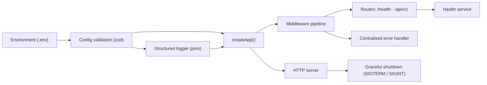

<div align="center">

  # Backly

  ### Clone it. Configure it. Build anything on top.

  **A modular, production-oriented Node.js backend foundation for starting new backend projects without rebuilding the core every time.**

  [](package.json)
  [](src/app.js)
  [](src/core/logger.js)
  [](tests)
  [](#what-is-intentionally-not-here)
  [](#roadmap)

  [Get started](#run-it-locally) · [Features](#features) · [API](#api-at-a-glance) · [Documentation](#documentation)
</div>

---

## The idea

Most backend starters give you a folder with `app.listen()` and call it a foundation. Backly gives you the parts that every real backend ends up needing anyway: validated configuration, predictable middleware, one error format, structured logs, health checks, graceful shutdown, and tests that run without a server.

It is deliberately opinionated about what it will _not_ pretend to be. Backly is not a framework, not a full platform, and not production-ready out of the box for every workload. It is a small, readable starting point that stays independent of any application domain, so a completely different project can be built on top of it without touching the core.


## Features

### Current capabilities

| Capability | What it gives you |
|---|---|
| **Application factory** | `createApp()` builds the Express app without starting a server, so it can be tested in-process and reused by different entry points. |
| **Environment configuration** | Centralised, validated at startup with zod. All problems are reported at once, and the config object is immutable. Supports `development`, `test`, and `production`. |
| **Middleware pipeline** | Request ID, request logging, security headers, CORS, rate limiting, and JSON parsing, always in the same predictable order. |
| **Centralised error handling** | One `AppError` class, one JSON error shape, a 404 fallback, and correct HTTP status codes. |
| **Structured logging** | JSON logs with levels, per-request correlation through the request ID, and redaction of common secret fields. |
| **Health endpoints** | Separate liveness and readiness endpoints, with a registry for future readiness checks. |
| **API versioning** | Routes are mounted under `/api/v1`, ready for `/api/v2` later. |
| **Graceful shutdown** | Handles `SIGTERM` and `SIGINT`, drains in-flight requests, and forces exit after a timeout. |
| **Automated tests** | Unit and integration tests on Node's built-in test runner. The HTTP layer is tested without a running server. |
| **CI** | A GitHub Actions workflow runs `npm ci` and `npm test` on every push to `main` and every pull request. |

### Built to show its working

Backly is written so that its behaviour can be checked, not just trusted:

- Configuration is validated before the server starts. If anything is wrong, the process prints every problem and exits with code 1.
- Unexpected errors always return a generic `500` with the message `Internal Server Error`. The real error and stack trace are only written to the logs.
- Request logs record the method, path (without the query string), status, and duration. Headers and bodies are never logged, and fields such as `authorization`, `cookie`, `password`, `token`, `secret`, and `apiKey` are redacted.
- Readiness never claims that a dependency is healthy unless a check actually ran. With no registered checks, it reports an empty `checks` list.
- While shutting down, readiness returns `503` so a load balancer can stop sending traffic, while liveness stays up until the process exits.

### Core modules

| Module | Role |
|---|---|
| **`config`** | Reads and validates environment variables and returns an immutable config object. Pure: it takes an `env` object and never reads files itself. |
| **`core`** | Logger creation, server startup, graceful shutdown, and the small shared lifecycle state. |
| **`middleware`** | Reusable Express middleware and the registration order. |
| **`routes`** | Route registration, health routes, and versioned routers. |
| **`errors`** | `AppError`, stable error codes, and factories for common HTTP errors. |
| **`services`** | Framework-independent logic. Currently the health service. |
| **`utils`** | Small shared helpers. |

## How a request flows

The middleware order is fixed and intentional. Each step relies on the ones before it.

```text
request ID  →  request logger  →  security headers  →  CORS  →  rate limiter  →  JSON parser  →  routes  →  404  →  error handler
```

1. **Request ID** is propagated from a valid incoming `X-Request-Id`, or generated as a UUID. Invalid values are replaced.
2. **Request logger** attaches a request-scoped logger and writes one line when the response finishes.
3. **Security headers** are set with Helmet's default policy, and `X-Powered-By` is removed.
4. **CORS** answers preflight requests before anything expensive runs. It is disabled unless origins are configured.
5. **Rate limiter** rejects abusive traffic before request bodies are parsed. Health endpoints are exempt.
6. **JSON parser** enforces a configurable body size limit.
7. **Routes** run your handlers. Async errors are caught automatically (Express 5).
8. **404 and error handler** turn anything unmatched or thrown into the standard error response.

## Architecture



| Layer | Location | Responsibility |
|---|---|---|
| **Entry point** | `src/server.js` | Loads `.env`, validates config, creates the logger and app, starts the server, registers shutdown handlers. |
| **App factory** | `src/app.js` | Builds the Express app with middleware, routes, and error handling in the right order. |
| **Config** | `src/config/` | Environment loading and validation. |
| **Core** | `src/core/` | Logger, server startup, shutdown, lifecycle state. |
| **Middleware** | `src/middleware/` | Request ID, logging, security, CORS, rate limiting, 404, error handler. |
| **Routes** | `src/routes/` | Health routes and the versioned API router. |
| **Errors** | `src/errors/` | Error class, error codes, HTTP error factories. |
| **Services** | `src/services/` | Logic that does not depend on Express. |
| **Tests** | `tests/` | Unit tests, in-process integration tests, and a few real-server tests. |

## Technologies used

| Technology | What it does in Backly | Where to verify |
|---|---|---|
| **Node.js 22+** | Runtime. ES Modules throughout. Built-in test runner and `.env` loading, with no extra packages. | `package.json`, `.nvmrc` |
| **Express 5** | HTTP framework. Automatic handling of async errors in route handlers. | `src/app.js` |
| **Helmet** | Security headers. | `src/middleware/security.js` |
| **cors** | Allowlist-based CORS, disabled by default. | `src/middleware/cors.js` |
| **express-rate-limit** | Configurable rate limiting with the standard error response. | `src/middleware/rateLimit.js` |
| **pino** | Structured JSON logging with redaction. | `src/core/logger.js` |
| **zod** | Environment variable validation. | `src/config/loadConfig.js` |
| **supertest** (dev) | Tests the Express app in-process, without opening a port. | `tests/integration/` |
| **GitHub Actions** | Runs the test suite on every push to `main` and every pull request. | `.github/workflows/ci.yml` |

## Run it locally

**Prerequisites:** Node.js 22 or newer. An `.nvmrc` is included if you use nvm.

### Quick start

```bash
git clone <your-repository-url> backly
cd backly
npm install
cp .env.example .env   # optional: every variable has a default
npm run dev
```

| Service | Default URL |
|---|---|
| API | http://127.0.0.1:3000 |
| Health | http://127.0.0.1:3000/health |
| Liveness | http://127.0.0.1:3000/health/live |
| Readiness | http://127.0.0.1:3000/health/ready |
| API v1 | http://127.0.0.1:3000/api/v1 |

Press Ctrl+C to stop. Backly drains in-flight requests before exiting.

### Try it

```bash
curl localhost:3000/health         # status and runtime info
curl localhost:3000/health/live    # liveness
curl localhost:3000/health/ready   # readiness
curl localhost:3000/api/v1         # API version check
curl localhost:3000/nope           # standard 404 error response
```

### Start it manually

```bash
npm start                         # run once, no file watching
NODE_ENV=production npm start     # production mode
PORT=8080 npm start               # different port
```

Logs are JSON lines on stdout. For readable output during development you can pipe them through a tool such as `pino-pretty` (not included as a dependency).

### Commands

| Command | Description |
|---|---|
| `npm start` | Start the server. |
| `npm run dev` | Start with automatic restart on file changes. |
| `npm test` | Run all tests. |
| `npm run test:unit` | Run unit tests only. |
| `npm run test:integration` | Run integration tests only. |
| `npm run test:coverage` | Run all tests with Node's experimental coverage report. |

## Configuration

Copy `.env.example` to `.env` for local overrides. Never commit `.env` or any secret. Real environment variables always take precedence over the file, and empty values count as "not set".

| Variable | Default | Purpose |
|---|---|---|
| `NODE_ENV` | `development` | `development`, `test`, or `production`. |
| `APP_NAME` | `nodeforge` | Service name used in logs and health output. |
| `HOST` | `127.0.0.1` | Bind address. Use `0.0.0.0` inside containers. |
| `PORT` | `3000` | Listening port. |
| `LOG_LEVEL` | by environment | `fatal`, `error`, `warn`, `info`, `debug`, `trace`, or `silent`. Default: `debug` (development), `info` (production), `silent` (test). |
| `JSON_BODY_LIMIT` | `100kb` | Maximum JSON request body size, such as `100kb` or `1mb`. |
| `CORS_ORIGINS` | empty | Comma-separated allowed origins, or `*`. Empty disables CORS. |
| `RATE_LIMIT_ENABLED` | `true` | Enable or disable rate limiting. |
| `RATE_LIMIT_WINDOW_MS` | `60000` | Rate limit window. |
| `RATE_LIMIT_MAX` | `100` | Maximum requests per client per window. |
| `TRUST_PROXY` | `0` | Number of reverse proxies in front of the app. |
| `SHUTDOWN_TIMEOUT_MS` | `10000` | Maximum wait for in-flight requests on shutdown. |

Set `APP_NAME=backly` in your `.env` to use the Backly name in logs and health output.

## API at a glance

Application endpoints are JSON. Operational endpoints are unversioned on purpose, so probes do not depend on API versions.

| Method | Endpoint | Use it for |
|---|---|---|
| `GET` | `/health` | Service name, version, environment, uptime, Node version, and memory. Returns `503` while shutting down. |
| `GET` | `/health/live` | Liveness. The process is running. Never checks dependencies. |
| `GET` | `/health/ready` | Readiness. Runs registered checks. Returns `503` if any fail or while shutting down. |
| `GET` | `/api/v1` | API version check. Confirms versioned routing works. |

### Error response format

Every error uses the same shape:

```json
{
  "error": {
    "code": "NOT_FOUND",
    "message": "Route GET /nope not found",
    "requestId": "be8a425d-091b-4f55-867a-612fee4cbceb"
  }
}
```

`details` appears only when an error explicitly provides client-safe details. The `requestId` matches the `X-Request-Id` response header and the request's log lines.

### Adding a feature

1. Create a router for your feature.
2. Mount it in `src/routes/v1/index.js` with `router.use('/<feature>', featureRouter)`.
3. Throw `AppError` or use `httpErrors` for expected failures.
4. Register readiness checks with `healthService.registerCheck(name, asyncFn)` when your feature depends on something external.

## What is intentionally not here

Backly stays domain-independent, so these are left out on purpose and not forgotten:

- No database and no ORM.
- No authentication or authorization.
- No business-specific endpoints. `/api/v1` only reports its own version.
- No frontend.

## Security, deployment, and boundaries

Backly is a foundation, not a finished production platform. Current safeguards include:

- Security headers through Helmet.
- CORS disabled by default, with an explicit origin allowlist when enabled.
- Configurable rate limiting and request body size limits.
- Safe production error responses with no stack traces or internal details.
- Secret-field redaction in logs, and no logging of headers, bodies, or query strings.
- Secure default bind address (`127.0.0.1`).
- No secrets in the repository, with `.env` ignored by Git.

Current limitations to know about:

- Rate limiting uses an in-memory store. Counters are per process, reset on restart, and are not shared between multiple instances.
- Readiness has no real dependency checks yet, because there are no dependencies yet.
- Shutdown behaviour is covered by tests with a real HTTP server and simulated process signals. It has not been verified under Docker or Kubernetes.
- No Dockerfile, linter, formatter, OpenAPI documentation, metrics, or tracing yet.
- No `LICENSE` file is included. Add one before publishing publicly.

## Quality checks

```bash
npm ci
npm test
npm run test:coverage
```

Tests cover:

- Configuration defaults, parsing, and validation errors.
- The error class, error normalisation, and the error response shape.
- Unexpected errors never leaking secrets, stack traces, or file paths, in every environment.
- Invalid JSON, oversized bodies, and unknown routes.
- Request ID generation, propagation, and replacement.
- Request logging, including redaction and query-string removal.
- Security headers, CORS allowlist behaviour, preflight, and rate limiting.
- Health, liveness, and readiness behaviour, including during shutdown.
- Real server startup, port conflicts, graceful shutdown, and forced exit on timeout.

Integration tests call the Express app in-process, and each test builds its own app and config, so tests are independent of each other.

## Project map

```text
backly/
├── src/
│   ├── app.js              # Application factory
│   ├── server.js           # Process entry point
│   ├── config/             # Environment loading and validation
│   ├── core/               # Logger, server startup, shutdown, lifecycle state
│   ├── middleware/         # Request ID, logging, security, CORS, rate limit, errors
│   ├── routes/             # Health routes and versioned routers (v1)
│   ├── errors/             # AppError, error codes, HTTP error factories
│   ├── services/           # Framework-independent logic (health service)
│   └── utils/              # Small shared helpers
├── tests/
│   ├── unit/               # Pure logic tests
│   ├── integration/        # In-process HTTP tests and real-server tests
│   └── helpers/            # Test app builder and log capture
├── .github/workflows/      # CI
├── .env.example            # Documented configuration template
└── package.json
```

## Roadmap

- [x] Application factory with a predictable middleware order.
- [x] Validated, environment-driven configuration.
- [x] Centralised error handling with safe production responses.
- [x] Structured logging with request correlation and redaction.
- [x] Liveness and readiness endpoints with an extensible check registry.
- [x] Graceful shutdown for `SIGTERM` and `SIGINT`.
- [x] Unit and integration test infrastructure, plus CI.

Planned next, not implemented yet:

- [ ] Linting and formatting.
- [ ] Dockerfile and container health check.
- [ ] Request validation layer.
- [ ] OpenAPI documentation.
- [ ] Authentication and authorization.
- [ ] Database integration.

## Documentation

- [Environment template](.env.example)
- [CI workflow](.github/workflows/ci.yml)
- [Application factory](src/app.js)
- [Configuration loader](src/config/loadConfig.js)
- [Middleware registration order](src/middleware/index.js)
- [Error handler](src/middleware/errorHandler.js)
- [Graceful shutdown](src/core/shutdown.js)

---

<div align="center">
  Built for a solid start—not for overpromising.
</div>
