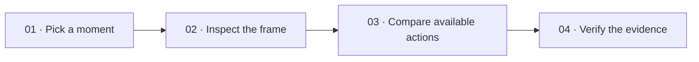
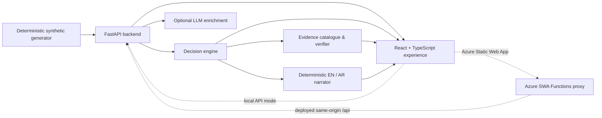
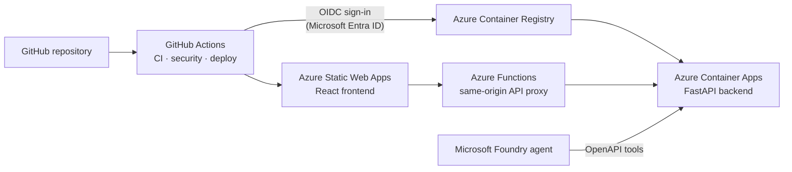

<div align="center">
  

  # ReMatch

  ### Rewind the moment. See the options. Follow the evidence.

  **An evidence-first football intelligence experience for exploring _why_ a decision mattered.**

  [](rematch-frontend)
  [](backend)
  [](api)
  [](#the-data-behind-the-demo)
  [](#roadmap)

  [Get started](#run-it-locally) · [Features](#features) · [API](#api-at-a-glance) · [Docs](#documentation)
</div>

---

## The idea

Most match products can tell you that a pass was played. ReMatch lets you stop on that moment, see the frame around it, compare the action with the options that were actually present, and trace every computed claim back to evidence.

It is deliberately opinionated about what it will _not_ pretend to know. ReMatch is a deterministic geometry-based explainer—not xG, a pass-completion model, betting advice, or proof that a footballer made the objectively “right” choice.



## Features

### Product surfaces

| Experience | What it gives you |
|---|---|
| **Dashboard** | Searchable synthetic fixture catalogue, status filters, and dataset overview stats. |
| **Match Centre** | Pitch replay, event timeline, highlights, score race, team/player analytics, and Match Studio. |
| **Fan / Analyst views** | Presentation toggle (local preference): pitch-first Fan experience vs denser Analyst workspace—same underlying match state. |
| **Match Studio** | LIVE chronological event feed (seek on select) and ASK for event-scoped agent narrative—no free-form match Q&A. |
| **Decision Explorer** | Backend-scored observed actions and frame-backed alternatives, ranked with transparent calculations. |
| **Ask the agents** | Composed decision analysis + evidence verifier + bilingual Narrator for the selected event. |
| **Event intelligence** | Evidence-grounded moment briefing for any stored event; optional server-side LLM enrichment (OpenAI-compatible or Gemini). |
| **Pick Your Pass** | Interactive inspection of alternatives already returned by the engine—no browser-side recalculation. |
| **Judge Mode** | Guided path for reviewers: open a seeded match, replay events, inspect decisions. |
| **Insights** | Match-level insights routed through the shared data-service boundary (mock/API, error/retry, RTL). |
| **System Metrics** | Persisted, measured API-operation telemetry (latency, success rates, verification totals)—not derived from fixture fiction. |
| **Broadcast overlay** | Optional timed strip + downloadable overlay JSON for a moment (synthetic). |
| **i18n / RTL** | English and Arabic UI strings with RTL layout support. |

### Built to show its working

Every decision analysis is grounded in one observable frame of synthetic match data:

- The backend, not an AI model or the UI, calculates scores and ranks.
- Alternatives are created only for teammates positioned in the event’s aligned frame.
- Claims include references to source events, frames, positions, and registered calculations.
- The verifier validates evidence/reference membership and calculation consistency; it does not certify free-form football truth.
- Optional LLM enrichment may rewrite briefing wording from a verified evidence pack only; `llmConnected` is true only after a validated provider response.
- The client keeps mock and API modes separate. An API failure is shown to the user—it never silently swaps in mock data.

### Local “agents” (deterministic composition)

| Agent | Role |
|---|---|
| **Decision analysis** | Geometric scoring (`geometric_progression_v1`) and alternative ranking from seeded events/frames. |
| **Narrator** | Deterministic English/Arabic narrative from a typed truth pack—no model call. |
| **Verifier** | Evidence-reference and registered-calculation checks; natural-language claim support is always `not_assessed`. |

Microsoft Foundry remains an **external** tooling path (OpenAPI export + agent instructions under `docs/`). The web app does not embed Foundry credentials or call cloud agents by default.

## How scoring works

The current method, `geometric_progression_v1`, asks a narrow and explainable question: **how far does an action progress toward the opponent’s goal in this coordinate system?**

```text
composite score = progressive distance + goal-proximity gain
```

`progressive distance` measures movement in the team’s attacking direction. `goal-proximity gain` measures the reduction in Euclidean distance to the centre of the opponent’s goal. Higher values mean more geometric progression—nothing more.

Recorded outcomes, xG, pressure estimates, passing-lane clearance, and completion probability are not mixed into this score. See the full [decision-engine notes](docs/decision-engine.md) for formulas, examples, evidence rules, and known limits.

## Architecture



| Layer | Stack | Responsibility |
|---|---|---|
| **Frontend** (`rematch-frontend/`) | React 19, TypeScript, Vite | Dark-mode football analysis UI, Fan/Analyst modes, EN/AR RTL, mock/API switching. |
| **Backend / API** (`backend/`) | FastAPI, Pydantic, SQLAlchemy, Alembic | Versioned `/api/v1` catalogue, decision analysis, narratives, evidence, event intelligence, metrics. |
| **SWA API proxy** (`api/`) | Azure Functions v4 | Same-origin `/api/v1` proxy for Azure Static Web Apps; injects bearer auth server-side. Not required for local Vite → FastAPI. |
| **Data** | SQLite locally (Postgres-compatible URL) | Idempotent synthetic seeds, fictional teams, typed events, aligned player frames. |
| **Delivery** | Docker, `uv`, Azure Container Apps template | Reproducible backend image and a reviewable deployment starting point. |

## Microsoft technologies used

Built for the **Microsoft Inside the Game Hackathon**. Rematch runs on Azure, uses GitHub for source control and automation, and exposes its decision-analysis API to a Microsoft Foundry agent as OpenAPI tools. Each row names the product, its role in this project, and where to verify it in the repository.



| Product | What it does in Rematch | Where to verify |
|---|---|---|
|  **Microsoft Foundry** | Hosts the Rematch agent. The agent calls the decision-analysis endpoints as OpenAPI tools and is instructed to explain only from tool output, never to invent numbers. | `docs/FOUNDRY_AGENT_INSTRUCTIONS.md`, `docs/rematch-foundry-openapi.json`, `docs/FOUNDRY_*.md` |
|  | Runs the FastAPI backend: read-only API, secret references for the bearer token, ingress and health probes. | `backend/containerapp.yaml`, `docs/AZURE_CONTAINER_APPS.md` |
|  | Stores the commit-tagged `rematch-api` image. The Container App pulls it with a system-assigned managed identity. | `.github/workflows/rematch-AutoDeployTrigger-*.yml` |
|  | Hosts the React frontend with single-page-app fallback routing. | `rematch-frontend/public/staticwebapp.config.json`, `.github/workflows/azure-static-web-apps-*.yml` |
|  | Static Web Apps managed API: a same-origin proxy that injects the bearer token on the server, allows only listed routes, and bounds request size, so no secret reaches the browser. | `api/src/functions/backendProxy.js` |
|  | Passwordless deployment: GitHub Actions signs in to Azure through OIDC federation, and the Container App uses a managed identity instead of stored registry credentials. | `azure/login` step in the deploy workflow |
|  | Deployment pre-checks, registry login, and Container App updates inside the pipeline. | `.github/workflows/rematch-AutoDeployTrigger-*.yml` |
|  | Source control, pull requests, and the project repository. | This repository |
|  | CI (backend tests; frontend tests and build), security (Python dependency audit and container vulnerability scan), and automated deployment to Azure. | `.github/workflows/ci.yml`, `security.yml`, deploy workflows |
|  | The language of the entire frontend, with strict typed API contracts. | `rematch-frontend/` |

> Microsoft, Azure, Microsoft Foundry, Microsoft Entra, GitHub, and TypeScript are trademarks of Microsoft Corporation or its affiliates. Logos and names appear only to identify the technologies used. Rematch is an independent hackathon submission and does not imply Microsoft endorsement.

## Run it locally

**Prerequisites:** Node.js 22+ (frontend), Python 3.11–3.14, and [uv](https://docs.astral.sh/uv/). The production image uses Python 3.12. Azure Functions Core Tools are only needed if you develop the SWA `api/` proxy itself.

### One command (backend API + frontend)

```bash
./scripts/run-local.sh
```

This syncs dependencies, runs migrations, seeds the synthetic catalogue, then starts:

| Service | Default URL |
|---|---|
| Frontend (API mode) | http://127.0.0.1:5173/ |
| Backend API | http://127.0.0.1:8000/ |
| Interactive docs | http://127.0.0.1:8000/docs |
| Health | http://127.0.0.1:8000/api/v1/health |

Press Ctrl+C to stop both.

If port `8000` is already taken:

```bash
REMATCH_API_PORT=8001 ./scripts/run-local.sh
```

Optional: `REMATCH_FE_PORT`, `REMATCH_API_HOST`, `REMATCH_FE_HOST`, or `--skip-setup` to skip sync/migrate/seed.

### Start each piece manually

#### 1. Backend (FastAPI — this is the local API)

```bash
cd backend
uv sync --locked --all-extras
cp .env.example .env
uv run alembic upgrade head
uv run rematch-seed
uv run uvicorn app.main:app --reload --host 127.0.0.1 --port 8000
```

#### 2. Frontend (API mode)

```bash
cd rematch-frontend
npm ci
npm run dev:api -- --host 127.0.0.1 --port 5173
```

`dev:api` uses the checked-in `.env.api` configuration and connects to the local backend. CORS defaults allow local Vite hosts on ports 5173 and 5174.

Sample Decision Explorer journey:

```text
http://127.0.0.1:5173/matches/m-p8-harbor-eastbridge-002/decisions/m-p8-harbor-eastbridge-002-evt-001-pass
```

#### 3. SWA API proxy (`api/`) — Azure deploy path

The `api/` package is the **Azure Static Web Apps** Functions proxy. Local day-to-day development does **not** need it: point the frontend at the FastAPI backend with `VITE_API_BASE_URL`.

For Static Web App deployment, the proxy:

- Allows a fixed allow-list of `/api/v1` routes
- Forwards to the configured Container Apps backend over HTTPS
- Attaches `API_BEARER_TOKEN` on the server (never in the browser)

```bash
cd api
npm ci
# Requires Azure Functions Core Tools + BACKEND_BASE_URL / API_BEARER_TOKEN
# for the deployed Container Apps host — see docs/AZURE_CONTAINER_APPS.md
```

### Or work entirely offline (frontend mock mode)

```bash
cd rematch-frontend
npm ci
npm run dev
```

Mock mode is the default. It uses bundled synthetic fixtures. Those fixtures intentionally have no aligned frames, so the Decision Explorer correctly has no alternatives to compare.

## Configuration

### Backend

Copy `backend/.env.example` to `backend/.env` for local overrides. Never commit this file or any secret.

| Variable | Default | Purpose |
|---|---|---|
| `APP_NAME` | `ReMatch API` | API title. |
| `APP_ENV` | `development` | `production` / `prod` disables interactive API documentation. |
| `REQUIRE_API_AUTH` | `false` | Require a bearer token for every `/api/v1` endpoint. |
| `API_BEARER_TOKEN` | unset | Required with authentication; must be at least 32 characters. |
| `DATABASE_URL` | `sqlite:///./rematch.db` | SQLAlchemy database URL. |
| `CORS_ORIGINS` | local Vite hosts | Comma-separated browser origins; empty disables CORS middleware. |
| `DEFAULT_PAGE_LIMIT` / `MAX_PAGE_LIMIT` | `50` / `100` | Pagination defaults and ceiling. |
| `LLM_ENABLED` | `false` | Optional event-intelligence enrichment. |
| `LLM_PROVIDER` | `openai` | `openai`, `azure_openai`, `openai_compatible`, or `gemini`. |
| `LLM_API_KEY` / `LLM_MODEL` / `LLM_BASE_URL` | — | OpenAI / Azure / compatible provider settings. |
| `GEMINI_API_KEY` / `GEMINI_MODEL` | unset / `gemini-3.5-flash-lite` | Gemini Developer API (when `LLM_PROVIDER=gemini`). |

Full LLM setup: [docs/llm-provider.md](docs/llm-provider.md). Keys stay on the API host only—never under `VITE_*` or the frontend.

### Frontend

| Variable | Default | Purpose |
|---|---|---|
| `VITE_MATCH_DATA_SOURCE` | `mock` | `mock` for bundled fixtures or `api` for FastAPI. |
| `VITE_API_BASE_URL` | empty | Required in API mode, for example `http://127.0.0.1:8000`. |

## API at a glance

All application endpoints are JSON under `/api/v1`; list endpoints use `{ items, total, limit, offset }`.

| Method | Endpoint | Use it for |
|---|---|---|
| `GET` | `/health` | Liveness check. |
| `GET` | `/matches` | Paginated, searchable fixture catalogue. |
| `GET` | `/matches/dataset` | Metadata for the preferred seeded scenario. |
| `GET` | `/matches/overview` | Dashboard statistics. |
| `GET` | `/matches/{match_id}` | Match summary. |
| `GET` | `/matches/{match_id}/events` | Event timeline. |
| `GET` | `/matches/{match_id}/frames` | Aligned player frames. |
| `GET` | `/matches/{match_id}/players` | Players referenced by that match. |
| `GET` | `/matches/{match_id}/context` | Coaches, form, squads, player stats. |
| `GET` | `/matches/{match_id}/player-stats` | Per-player match stats. |
| `GET` | `/matches/{match_id}/intelligence` | Match-level aggregates from seeded events/frames. |
| `POST` | `/matches/{match_id}/start` | Start an upcoming synthetic match on request. |
| `GET` | `/system-metrics` | Measured API-operation telemetry. |
| `GET` | `…/events/{event_id}/decision-analysis` | Observed action, alternatives, scores, rankings, claims. |
| `GET` | `…/decision-analysis/narrative` | Deterministic bilingual agent composition. |
| `GET` | `…/decision-analysis/evidence` | Evidence bundle and validation context. |
| `POST` | `…/decision-analysis/verify` | Validate supplied evidence references and calculations. |
| `GET` | `…/event-intelligence` | Evidence briefing; optional LLM enrichment. |

Exact request/response shapes: [API contract](docs/api-contract.md).

## The data behind the demo

Everything bundled with ReMatch is fictional and labelled as synthetic.

- Compatibility and generated scenarios are seeded together (idempotent). Preferred catalogue metadata is returned by `GET /matches/dataset`.
- Rich demo fixtures include live clocks, finished matches, upcoming start-on-request, assists, cards, substitutions, coaches, and form history.
- Phase 8-style generated matches retain full 11v11 rosters and aligned decision frames for Decision Explorer journeys.
- Alternatives exist only where an event has an aligned frame with eligible teammate positions. Missing options are never inferred.
- The generator is deterministic: the same seed and parameters produce the same logical dataset.

Read the [data model](docs/data-model.md) and [generator guide](docs/data-generator.md) for schema, constraints, and reproducibility.

## Security, deployment, and boundaries

ReMatch is a read-only demo architecture, not a production match platform. Current safeguards include:

- Pinned direct dependencies, committed lockfiles, and scheduled dependency-audit workflows.
- A non-root Docker image and reproducible production dependency installation.
- Documentation endpoints disabled in production mode.
- Optional fail-closed bearer authentication for a development tunnel or protected demo.
- SWA Functions proxy keeps bearer tokens server-side for browser clients on Azure.
- No user accounts, write APIs (beyond demo `start`), WebSockets, or live data feeds in this repository.

SQLite storage at `/tmp/rematch/rematch.db` inside the container is ephemeral. The supplied [Azure Container Apps template](backend/containerapp.yaml) is a reviewable starting point only; read the [deployment guide](docs/AZURE_CONTAINER_APPS.md) before creating cloud resources.

## Quality checks

```bash
# Frontend
cd rematch-frontend
npm ci
npm audit --audit-level=high
npm run lint
npm run typecheck
npm run test
npm run build

# Backend
cd ../backend
uv lock --check
uv run --locked pytest

# Optional: with the seeded API running
cd ../rematch-frontend
npm run smoke:decision
```

Tests cover UI behavior, the API contract, synthetic generation and seeding, geometry scoring, evidence verification, deterministic narration, event intelligence / LLM boundaries, authentication behavior, and production-documentation protection.

## Project map

```text
Rematch/
├── rematch-frontend/       # React + TypeScript product experience
├── backend/                # FastAPI service, migrations, decision engine, seed generator
├── api/                    # Azure Static Web Apps Functions proxy (/api/v1)
├── docs/                   # API, data, decision, verifier, narrator, LLM, deployment
├── logo/                   # Brand assets (1x / 2x / SVG)
├── scripts/run-local.sh    # One-command local API + frontend
└── .github/workflows/      # Dependency and security automation
```

## Roadmap

- [x] Typed football analysis UI, synthetic catalogue, pitch and timeline.
- [x] Deterministic decision engine with evidence and claim-reference verification.
- [x] Frame-backed alternatives, bilingual deterministic narration, and API-backed journeys.
- [x] Match Centre Fan/Analyst modes, Match Studio LIVE/ASK, Judge Mode, Pick Your Pass.
- [x] Event intelligence briefings with optional server-side LLM enrichment (incl. Gemini).
- [x] Locked dependencies, audit automation, production docs protection, and containerized API setup.
- [x] System Metrics from persisted API telemetry; mock mode reports no operational history.
- [x] Insights through the shared data-service boundary with mock/API, error/retry, and RTL coverage.
- [x] Azure SWA API proxy for same-origin authenticated backend access.
- [ ] Add durable storage and a real data-ingestion pipeline.
- [ ] Design identity, authorization, and production operations for a real deployment.
- [ ] Evaluate broader external AI/Foundry product integration under a separate security and data-rights review.

## Documentation

- [Frontend guide](rematch-frontend/README.md)
- [Backend guide](backend/README.md)
- [API contract](docs/api-contract.md)
- [Decision engine](docs/decision-engine.md)
- [Verifier contract](docs/verifier.md)
- [Narrator contract](docs/narrator.md)
- [LLM provider](docs/llm-provider.md)
- [Data model](docs/data-model.md)
- [Synthetic-data generator](docs/data-generator.md)
- [Azure Container Apps](docs/AZURE_CONTAINER_APPS.md)
- [Foundry connect](docs/FOUNDRY_CONNECT.md)
- [Judge guide](docs/judge/JUDGE_GUIDE.md)
- [Agents integration status](AGENTS_INTEGRATION_STATUS.md)

---

<div align="center">
  Built for better questions about the game—not overconfident answers.
</div>
