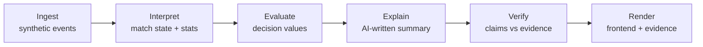
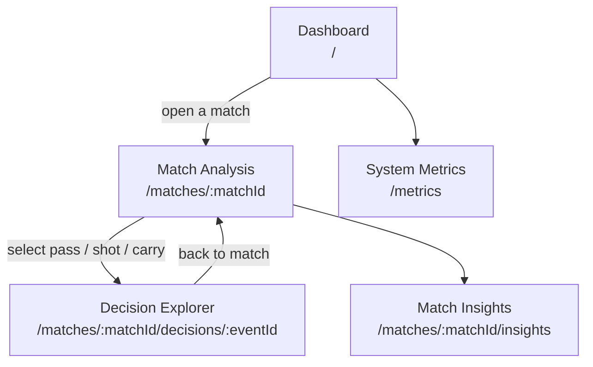

<div align="center">

# Rematch

### Don't just watch what happened. Understand why it happened.

**An explainable football intelligence platform that compares what a player actually did with what they could have done, and shows the evidence.**


[Live Demo](#demo) · [Demo Video](#demo) · [How It Works](#how-it-works) · [Getting Started](#getting-started)

<!-- Add a screenshot or GIF of the Decision Explorer here -->
<!--  -->

</div>

---

## Why Rematch?

Match dashboards show **what** happened: passes, shots, possession. They rarely explain **why a decision mattered**. AI-generated commentary can sound convincing while inventing facts.

Rematch is built around one question:

> **"What could have happened if the player had chosen differently?"**

For any key moment (a pass, a shot, or a carry), Rematch compares the action the player took against plausible alternatives, scores each one with a transparent decision-value model, and explains the difference in plain language. Every claim links back to the events and calculations behind it.

> **Code calculates the values. AI explains them.** Rematch never asks a language model to invent match statistics.

---

## Features

> Features below are **planned**. A feature is marked done only after it is implemented and tested in this repository (see [Current Status](#current-status)).

- **Decision Explorer:** compare an actual action with plausible alternatives.
- **Interactive Match View:** 2D pitch, score, event timeline, and key moments.
- **Evidence Drawer:** inspect the exact events and calculations behind any claim.
- **Match Insights:** summaries, player metrics, and match-momentum charts.
- **Fan & Analyst Modes:** accessible explanations or detailed analysis.
- **English & Arabic UI:** interface and explanations in both languages.
- **Verified Explanations:** unsupported claims are rejected, corrected, or replaced with a safe fallback.
- **System Metrics:** evidence support, verifier outcomes, and explanation latency.
- **Synthetic Match Simulator:** fictional match events for repeatable demos and tests.

---

## How It Works



| Step | What happens |
|------|--------------|
| **1. Ingest** | Receive synthetic events: passes, shots, tackles, pressure, possession changes. |
| **2. Interpret** | Update match state and compute statistics with deterministic code. |
| **3. Evaluate** | Score the actual action and plausible alternatives with the decision-value model. |
| **4. Explain** | Generate a readable explanation from the calculated results only. |
| **5. Verify** | Check every claim against available event IDs and calculations. |
| **6. Render** | Show the analysis, evidence, and events in the UI. |

> **Note:** Decision values are **model estimates**, not objective probabilities or guaranteed predictions of real-world outcomes.

---

## Pages

| Page | Purpose |
|------|---------|
| **Dashboard** | Browse matches and open an analysis. |
| **Match Analysis** | Explore the pitch, score, timeline, and key moments. |
| **Decision Explorer** | Compare a player's decision with alternatives. |
| **Match Insights** | Review summaries and performance insights. |
| **System Metrics** | Inspect reliability and performance measurements. |
| **Settings** *(optional)* | Choose language and analysis mode. |

---

## Sitemap

> Planned navigation and routes. Paths and endpoints may change during development.



### Routes

| Route | Page | Purpose | Planned API |
|-------|------|---------|-------------|
| `/dashboard` (and `/` → redirect) | Dashboard | Browse sample matches and open an analysis | `GET /api/v1/matches` |
| `/matches/:matchId` | Match Analysis | 2D pitch, score, event timeline, inspector | `GET /api/v1/matches/{id}`, `…/events`, `…/frames`, `…/players` |
| `/matches/:matchId/decisions/:eventId` | Decision Explorer | Compare observed action with geometric alternatives + evidence claims | `GET /api/v1/matches/{id}/events/{eventId}/decision-analysis` |
| `/matches/:matchId/insights` | Match Insights | Summaries, player metrics *(placeholder)* | — |
| `/metrics` | System Metrics | Reliability measurements *(placeholder)* | — |
| Language toggle | Sidebar EN/AR | Interface locale + RTL | client-side |

### Navigation Tree

```text
Rematch
├── Dashboard                      /dashboard
│   └── Match Analysis             /matches/:matchId
│       ├── Decision Explorer      /matches/:matchId/decisions/:eventId
│       └── Match Insights         /matches/:matchId/insights (placeholder)
└── System Metrics                 /metrics (placeholder)
```

---

## Tech Stack

> This is the **intended** architecture. It will be updated to match what is actually used.

| Layer | Technology |
|-------|------------|
| Frontend | React, TypeScript, SVG pitch visualizations |
| Backend API | Python, FastAPI |
| Live updates | WebSockets (if needed for the event stream) |
| Storage | SQLite (PostgreSQL only if required) |
| Analytics & simulation | Python, NumPy, Pandas |
| AI orchestration | Microsoft Foundry and Microsoft Agent Framework *(subject to availability)* |
| Testing | Vitest + React Testing Library (frontend); pytest + HTTPX (backend) |
| Automation | Git, GitHub, GitHub Actions |

---

## Getting Started

**Prerequisites:** Node.js 20+, npm 10+, Git, Python 3.11+ (3.12 recommended for the backend).

### End-to-end (Decision Explorer with live engine)

**1. Backend**

```bash
cd backend
python3.12 -m venv .venv
source .venv/bin/activate        # Windows: .venv\Scripts\activate
pip install -e ".[dev]"
cp .env.example .env
alembic upgrade head
rematch-seed
uvicorn app.main:app --reload --host 0.0.0.0 --port 8000
```

- Health: http://localhost:8000/api/v1/health  
- OpenAPI: http://localhost:8000/docs  
- CORS defaults allow the local Vite origins on ports `5173` and `5174` (`CORS_ORIGINS` in `backend/.env`)

**2. Frontend (API mode)**

```bash
cd rematch-frontend
npm install
npm run dev:api -- --host 127.0.0.1 --port 5173
```

The `dev:api` script loads the checked-in `.env.api` (`VITE_MATCH_DATA_SOURCE=api`, API at `http://127.0.0.1:8000`). Vite uses `5173` when free and may fall back to `5174` if another process already owns it. Both local ports are allowed by the backend CORS defaults. Open the URL Vite prints, then choose a Phase 8 match and an event with an aligned frame to inspect the available alternatives.

**3. Frontend (mock mode — default, offline)**

```bash
VITE_MATCH_DATA_SOURCE=mock
# VITE_API_BASE_URL can stay empty
npm run dev
```

Mock Decision Explorer fixtures are static and labelled synthetic. Alternatives are empty (no frames in `rematch-phase2-v1`). There is **no** silent fallback from API failures to mock data.

### Verify

```bash
# Frontend
cd rematch-frontend
npm run test
npm run lint
npm run typecheck
npm run build

# Optional live-backend smoke (backend must be running + seeded)
npm run smoke:decision

# Backend
cd ../backend && source .venv/bin/activate && pytest
```

Details: [backend/README.md](backend/README.md) · [rematch-frontend/README.md](rematch-frontend/README.md) · [docs/api-contract.md](docs/api-contract.md) · [docs/decision-engine.md](docs/decision-engine.md)

**Never commit secrets, API keys, credentials, or `.env` files.**

---

## Project Structure

```text
Rematch/
├── rematch-frontend/   # React + TypeScript + Vite UI (Phase 1–3, 6)
├── backend/            # FastAPI + SQLAlchemy + Alembic (Phase 4–5)
├── docs/               # Data model, API contract, decision engine
│   ├── data-model.md
│   ├── api-contract.md
│   └── decision-engine.md
└── README.md
```

---

## Evaluation & Testing

Rematch is measured, not just described. Planned metrics:

| Metric | Question it answers |
|--------|---------------------|
| **Evidence support rate** | How many explanation claims are backed by referenced events and calculations? |
| **Verifier rejection rate** | How often are unsupported claims caught? |
| **Correction success rate** | How often does a corrected explanation pass verification? |
| **Explanation latency** | How long from an event arriving to an explanation on screen? |
| **Key-moment coverage** | How many important moments receive analysis? |

Metrics come from recorded test runs and are reported honestly. **No placeholder numbers are published as measured results.**

```bash
# Frontend tests
cd rematch-frontend && npm run test

# Backend tests
cd backend && source .venv/bin/activate && pytest
```

---

## Responsible Use

- The demo uses **synthetic football data** with fictional teams and players, unless data rights and hackathon rules permit otherwise.
- Decision values are estimates, never certainties.
- Every explanation links back to supporting events and calculations.
- Unsupported claims are rejected, corrected, or replaced with a safe fallback.
- Rematch is an analytics and explanation prototype, **not** a betting or gambling product.

---

## Current Status

**Status: In development — Phase 9 local production-readiness validation complete**

- [x] Frontend foundation: Dark Pro shell, routing, dashboard with synthetic demo matches
- [x] Typed service boundaries and richer mock/event data (Phase 2)
- [x] Interactive match pitch and timeline (Phase 3)
- [x] Backend / API foundation (Phase 4)
- [x] Decision-value calculations, alternative comparison, and evidence verification (Phase 5)
- [x] Decision Explorer UI + typed `/api/v1` client integration (Phase 6)
- [x] Pick Your Pass selection of backend-scored frame alternatives (Phase 7)
- [x] Deterministic synthetic match generator + full-XI decision frames (Phase 8)
- [x] Phase 8 data integrated in API catalogue and validated through match → event/frame → decision analysis (Phase 9)
- [x] Coordinate-backed dashboard moment count; repeatable API journey smoke and Arabic/English UI coverage
- [ ] AI / Foundry explanations
- [ ] Demo deployment and production operations review

### Decision metrics (`geometric_progression_v1`)

| Metric | Meaning |
|--------|---------|
| `progressive_distance` | Attack-direction Δx in pitch-percent units |
| `goal_proximity_gain` | Reduction in Euclidean distance to opponent goal centre |
| `path_length` | Euclidean start→end length |
| `start_distance_to_goal` / `end_distance_to_goal` | Distances to goal centre |
| `composite_score` | `progressive_distance + goal_proximity_gain` |

A **higher geometric composite score does not establish a better real-world football decision**. It only ranks actions under this transparent geometry method. It is not xG, probability, or proof of correctness. Outcomes (`complete`, `goal`, …) are context only and are not mixed into the score.

### Synthetic-data limitations

- Frontend mock (`rematch-phase2-v1`): no frames → Decision Explorer fixtures have empty alternatives and show a mock banner.
- Backend seeds (`rematch-phase4-v1` + `rematch-phase8-v1`): Phase 4 remains for compatibility; Phase 8 adds three generated matches and 43 aligned full-XI frames.
- Alternatives exist only for teammates present in an aligned frame — absent options are not evaluated.

**Phase 6 notes**

- Route: `/matches/:matchId/decisions/:eventId` via Match Analysis CTA on pass/shot/carry.
- Service: `getDecisionAnalysis` on mock + API (`GET …/decision-analysis`). Claims/statuses come from that response; UI does not call `…/evidence` or `…/verify` yet.
- States: loading, ready, 404, 422 insufficient evidence, network error + retry, empty alternatives, missing frames. Stale-response guard + success cache in `useDecisionAnalysis`.
- EN/AR + RTL. See [docs/decision-engine.md](docs/decision-engine.md).

**Phase 8 notes**

- Deterministic generator (`rematch-phase8-generator` v1.0.0) under `backend/app/simulation/generator/`.
- Scenario `rematch-phase8-v1`: three full matches, each with ≥10 eligible decision moments and 22-player frames.
- Optional event metric columns: `distance_m`, `duration_s`, `ball_speed_mps`, `shot_speed_mps` (`path_metrics_v1`).
- See [docs/data-generator.md](docs/data-generator.md). Canonical club name: **Riverside United**.

**Phase 9 notes**

- `rematch-seed` applies both the Phase 4 compatibility fixtures and Phase 8 generated dataset. The dataset endpoint prefers Phase 8 when available; the match list includes both.
- Dashboard decision-moment count is derived from seeded pass/carry/shot events with the required coordinates. It is not an outcome or match-importance metric.
- Backend integration tests and the live API journey smoke cover dataset → match → events/frames/players → decision analysis, plus missing and insufficient-evidence cases.
- The default frontend remains explicit mock mode. Use `VITE_MATCH_DATA_SOURCE=api` to browse Phase 8; API failures never silently fall back to static mock data.
- Local validation does not constitute a deployment, security, load, or real-world match-data review. See [PHASE9_REPORT.md](PHASE9_REPORT.md) for exact commands and results.

**Phase 7 notes**

- Pick Your Pass is available inside Decision Explorer (also from the existing `/pick-your-pass` route).
- It selects only alternatives returned by `GET .../decision-analysis`, displays the backend score, rank and matching evidence claim, and highlights the returned path on the existing SVG pitch when coordinates and an aligned frame are available.
- There is no selection submission endpoint: the backend already computes and returns scores/ranks for all frame-backed alternatives. The UI does not rescore or post hypothetical geometry.
- No API contract change was needed. With no alternatives or usable coordinates, the UI reports the unavailable state. Mock selections are explicitly labelled synthetic.

**Phase 5 notes**

- Deterministic engine under `backend/app/services/decision/`.
- Endpoints: `…/decision-analysis`, `…/evidence`, `…/verify`.

**Phase 4 notes**

- FastAPI + SQLAlchemy + Alembic + seed `rematch-phase4-v1` (includes sample frames).
- Versioned REST under `/api/v1` with paginated list envelopes.

---

## Demo

- **Live demo:** _coming soon_
- **Demo video:** _coming soon_
- **Screenshots:** _to be added from the working application_

---

## Contributing

Contributions and feedback are welcome. Open an issue to discuss your idea before sending a pull request, and keep changes focused and tested.

---

## Team

| Name | Role | GitHub |
|------|------|--------|
| Omar Alnajjar | Backend engineer | [@omar-hady](https://github.com/omar-hady) |
| Adam Ahmed | Software engineer| [@Adamzuckk](https://github.com/Adamzuckk) |
| Youssef Mohammed | Pentester | [@Captain10Joe](https://github.com/Captain10Joe) |
| Yousef Abass | AI engineer | [@Youssef-3bas](https://github.com/Youssef-3bas) |
---

## License

_Add a license (e.g. MIT) and a `LICENSE` file before the final submission._

---

## Acknowledgements

Developed for the **Microsoft Inside the Game Hackathon**. Microsoft, the Premier League, and their respective marks belong to their owners. Rematch is an independent hackathon submission and does not imply official endorsement.

<div align="center">

**Rematch: every explanation should have evidence.**

</div>
