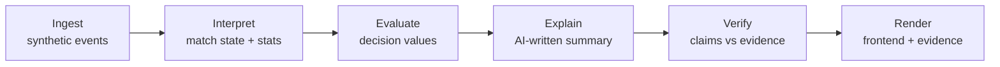
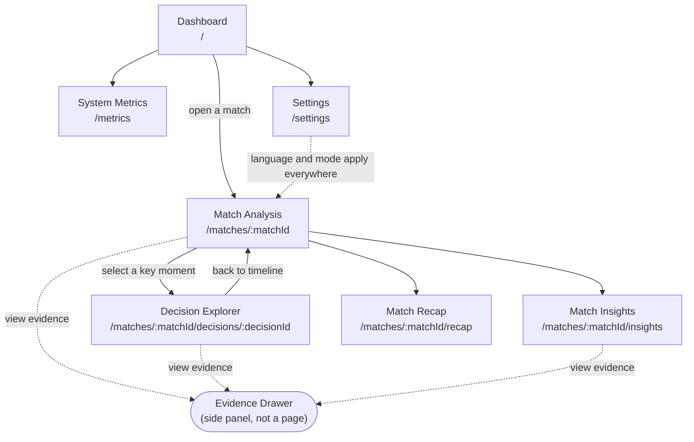

<div align="center">

# Rematch

### Don't just watch what happened. Understand why it happened.

**An explainable football intelligence platform that compares what a player actually did with what they could have done, and shows the evidence.**


[Live Demo](#demo) · [Demo Video](#demo) · [How It Works](#how-it-works) · [Getting Started](#getting-started)

<!-- Add a screenshot or GIF of the Decision Explorer here -->
<!--  -->

</div>

---

## Why Rematch?

Match dashboards show **what** happened: passes, shots, possession. They rarely explain **why a decision mattered**. AI-generated commentary can sound convincing while inventing facts.

Rematch is built around one question:

> **"What could have happened if the player had chosen differently?"**

For any key moment (a pass, a shot, or a carry), Rematch compares the action the player took against plausible alternatives, scores each one with a transparent decision-value model, and explains the difference in plain language. Every claim links back to the events and calculations behind it.

> **Code calculates the values. AI explains them.** Rematch never asks a language model to invent match statistics.

---

## Features

> Features below are **planned**. A feature is marked done only after it is implemented and tested in this repository (see [Current Status](#current-status)).

- **Decision Explorer:** compare an actual action with plausible alternatives.
- **Interactive Match View:** 2D pitch, score, event timeline, and key moments.
- **Evidence Drawer:** inspect the exact events and calculations behind any claim.
- **Match Insights:** summaries, player metrics, and match-momentum charts.
- **Fan & Analyst Modes:** accessible explanations or detailed analysis.
- **English & Arabic UI:** interface and explanations in both languages.
- **Verified Explanations:** unsupported claims are rejected, corrected, or replaced with a safe fallback.
- **System Metrics:** evidence support, verifier outcomes, and explanation latency.
- **Synthetic Match Simulator:** fictional match events for repeatable demos and tests.

---

## How It Works



| Step | What happens |
|------|--------------|
| **1. Ingest** | Receive synthetic events: passes, shots, tackles, pressure, possession changes. |
| **2. Interpret** | Update match state and compute statistics with deterministic code. |
| **3. Evaluate** | Score the actual action and plausible alternatives with the decision-value model. |
| **4. Explain** | Generate a readable explanation from the calculated results only. |
| **5. Verify** | Check every claim against available event IDs and calculations. |
| **6. Render** | Show the analysis, evidence, and events in the UI. |

> **Note:** Decision values are **model estimates**, not objective probabilities or guaranteed predictions of real-world outcomes.

---

## Pages

| Page | Purpose |
|------|---------|
| **Dashboard** | Browse matches and open an analysis. |
| **Match Analysis** | Explore the pitch, score, timeline, and key moments. |
| **Decision Explorer** | Compare a player's decision with alternatives. |
| **Match Insights** | Review summaries and performance insights. |
| **System Metrics** | Inspect reliability and performance measurements. |
| **Settings** *(optional)* | Choose language and analysis mode. |

---

## Sitemap

> Planned navigation and routes. Paths and endpoints may change during development.



### Routes

| Route | Page | Purpose | Planned API |
|-------|------|---------|-------------|
| `/` | Dashboard | Browse sample matches and open an analysis | `GET /api/matches` |
| `/matches/:matchId` | Match Analysis | 2D pitch, score, event timeline, key moments, live event stream | `GET /api/matches/{id}`, `GET /api/matches/{id}/events`, stream endpoint |
| `/matches/:matchId/decisions/:decisionId` | Decision Explorer | Compare the actual action with plausible alternatives, with explanation | `GET /api/decisions/{id}` |
| `/matches/:matchId/insights` | Match Insights | Summaries, player metrics, momentum charts, Player Focus mode | `GET /api/matches/{id}/insights` |
| `/matches/:matchId/recap` | Match Recap | Automated recap in English and Arabic | `GET /api/matches/{id}/recap` |
| `/metrics` | System Metrics | Evidence support rate, verifier outcomes, latency (from recorded runs) | `GET /api/metrics` |
| `/settings` | Settings | Language (EN/AR), Fan/Analyst mode, favorite club and player | stored client-side |
| *(panel)* | Evidence Drawer | Events and calculations behind any claim | `GET /api/evidence/{claimId}` |

### Navigation Tree

```text
Rematch
├── Dashboard                      /
│   └── Match Analysis             /matches/:matchId
│       ├── Decision Explorer      /matches/:matchId/decisions/:decisionId
│       ├── Match Insights         /matches/:matchId/insights
│       ├── Match Recap            /matches/:matchId/recap
│       └── Evidence Drawer        (opens from any analysis page)
├── System Metrics                 /metrics
└── Settings                       /settings
```

---

## Tech Stack

> This is the **intended** architecture. It will be updated to match what is actually used.

| Layer | Technology |
|-------|------------|
| Frontend | React, TypeScript, SVG pitch visualizations |
| Backend API | Python, FastAPI |
| Live updates | WebSockets (if needed for the event stream) |
| Storage | SQLite (PostgreSQL only if required) |
| Analytics & simulation | Python, NumPy, Pandas |
| AI orchestration | Microsoft Foundry and Microsoft Agent Framework *(subject to availability)* |
| Testing | pytest |
| Automation | Git, GitHub, GitHub Actions |

---

## Getting Started

> **Note:** Setup will be finalized once the repository structure and dependencies are settled. The steps below show the intended workflow; commands are placeholders until then.

**Prerequisites:** Python 3.11+, Node.js 20+, Git

```bash
# 1. Clone the repository
git clone https://github.com/<your-username>/rematch.git
cd rematch

# 2. Backend
cd backend
python -m venv .venv
source .venv/bin/activate        # Windows: .venv\Scripts\activate
pip install -r requirements.txt
cp .env.example .env             # then fill in your own values
uvicorn app.main:app --reload

# 3. Frontend (in a second terminal)
cd frontend
npm install
npm run dev
```

Open the local URL shown by the dev server and select a sample match.

**Never commit secrets, API keys, credentials, or `.env` files.**

---

## Project Structure

```text
rematch/
├── frontend/     # React + TypeScript UI
├── backend/      # FastAPI service, simulator, decision-value engine
├── docs/         # Architecture notes and extended documentation
├── tests/        # pytest suites
├── .gitignore
└── README.md
```

> Adjust this tree to match the real repository.

---

## Evaluation & Testing

Rematch is measured, not just described. Planned metrics:

| Metric | Question it answers |
|--------|---------------------|
| **Evidence support rate** | How many explanation claims are backed by referenced events and calculations? |
| **Verifier rejection rate** | How often are unsupported claims caught? |
| **Correction success rate** | How often does a corrected explanation pass verification? |
| **Explanation latency** | How long from an event arriving to an explanation on screen? |
| **Key-moment coverage** | How many important moments receive analysis? |

Metrics come from recorded test runs and are reported honestly. **No placeholder numbers are published as measured results.**

```bash
# Run backend tests
cd backend && pytest
```

---

## Responsible Use

- The demo uses **synthetic football data** with fictional teams and players, unless data rights and hackathon rules permit otherwise.
- Decision values are estimates, never certainties.
- Every explanation links back to supporting events and calculations.
- Unsupported claims are rejected, corrected, or replaced with a safe fallback.
- Rematch is an analytics and explanation prototype, **not** a betting or gambling product.

---

## Current Status

**Status: In development**

- [ ] Repository and API foundation
- [ ] Frontend core pages
- [ ] Frontend/backend integration
- [ ] Synthetic match simulator and validation tests
- [ ] Decision-value calculations and alternative comparison
- [ ] Evidence-linked explanations and verification
- [ ] Demo deployment and final testing

---

## Demo

- **Live demo:** _coming soon_
- **Demo video:** _coming soon_
- **Screenshots:** _to be added from the working application_

---

## Contributing

Contributions and feedback are welcome. Open an issue to discuss your idea before sending a pull request, and keep changes focused and tested.

---

## Team

| Name | Role | GitHub |
|------|------|--------|
| Omar Alnajjar | backend engineer | [@omar-hady](https://github.com/omar-hady) |
| Adamm Ahmed | software engineer| [@Adamzuckk](https://github.com/Adamzuckk) |
| youssef mohamed | pentester | [@Captain10Joe](https://github.com/Captain10Joe) |
| yousef abass | ai engineer | [@Youssef-3bas](https://github.com/Youssef-3bas) |
---

## License

_Add a license (e.g. MIT) and a `LICENSE` file before the final submission._

---

## Acknowledgements

Developed for the **Microsoft Inside the Game Hackathon**. Microsoft, the Premier League, and their respective marks belong to their owners. Rematch is an independent hackathon submission and does not imply official endorsement.

<div align="center">

**Rematch: every explanation should have evidence.**

</div>
